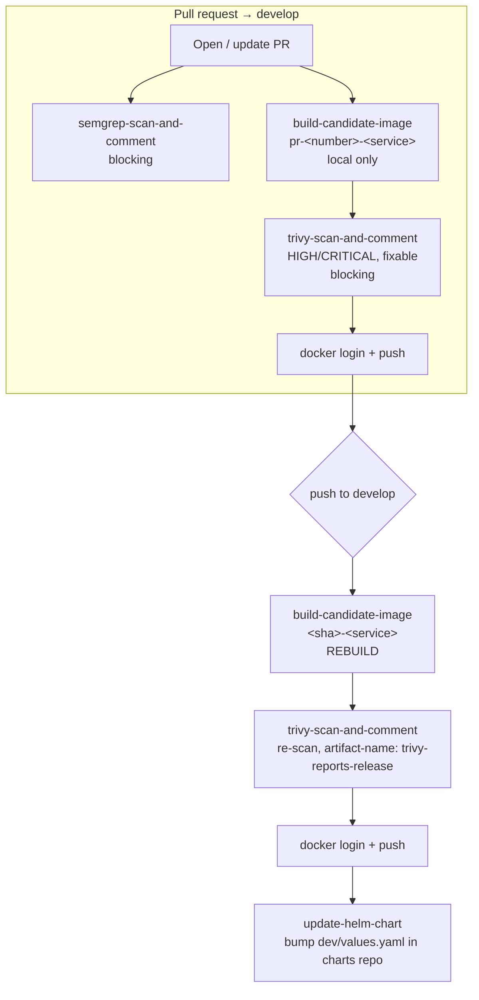

# Dev pipeline (`dev-pipeline.yml`)

PR into `develop` → scan → build → merge → rebuild + rescan → deploy.

The step-level logic lives **once**, as the composite actions in
[`.github/actions/`](../../.github/actions/README.md). The pipeline *shape*
itself also lives once, as the
[`dev-pipeline.yml` reusable workflow](../../.github/workflows/dev-pipeline.yml):
every app repo's `dev-pipeline.yml` is a thin trigger block plus one `uses:`
job calling it, rendered from
[the template](../../pipelines/templates/dev-pipeline.yml.tmpl). The
alternative — one file copy-pasted into fifteen repos — drifts: a gate gets
quietly disabled in one, a fix lands in three, nobody knows which are current.

## Build on the PR, rebuild and rescan on merge

The PR candidate and the deployed image are **two separate builds** from the
same source. The PR builds and scans a candidate tag; merging to `develop`
rebuilds and rescans from scratch, under the release tag. The alternative -
retagging the PR's already-scanned candidate by digest, no rebuild - relies on
resolving which PR produced a merge commit, which silently breaks under
squash/rebase merges, and never actually re-validates the bits reaching the
registry. Rebuilding costs one extra build+scan per merge; it has no PR to
resolve, and it scans what's actually pushed.

`build-candidate-image` also never pushes: build → scan → login → push, so an
image failing its Trivy gate never reaches the registry - true for both the
PR candidate and the merge rebuild.

## Flow

## Actions, in order

| Step | Action | Notes |
|---|---|---|
| SAST | `semgrep-scan-and-comment` | configs matched to the repo's stack |
| Build | `build-candidate-image` | does not push |
| Container scan | `trivy-scan-and-comment` | blocking by default — this is the gate |
| Rebuild | `build-candidate-image` + `trivy-scan-and-comment` (again) | `push` only; rebuilds and rescans rather than promoting the PR candidate by digest |
| Values bump | `update-helm-chart` | direct commit to the charts repo |

`validate-branch-jira` exists but is opt-in — no template wires it in.

## Tags

| Tag | Format | Notes |
|---|---|---|
| Candidate | `pr-<number>-<service>` | stable across force-pushes; not for deploying |
| Release | `<commit-sha>-<service>` | the commit that landed on `develop`; what gets deployed |

## What a direct push to `develop` does

The push job has no dependency on a PR having existed at all — it just
rebuilds and rescans whatever is on `develop` after the push. A direct push
(bypassing a PR) still gets built, Trivy-scanned, and deployed if it passes;
it just never went through Semgrep or a PR comment, since both are
`pull_request`-only. That's a real gap for a repo that wants SAST enforced on
every change reaching `develop` — branch protection requiring the PR workflow
is what closes it, not this pipeline.

## Registry

GHCR at `ghcr.io/${{ github.repository }}`, pushed with `GITHUB_TOKEN` and
`packages: write` — nothing to provision.

- **GHCR paths must be lowercase.** If your owner or repo name has uppercase
  letters, set `IMAGE_NAME` explicitly in the workflow's `env:`.
- **The first push creates a private package.** Fine for the pipeline itself;
  anything pulling from outside the repo needs its access widened once.

## Charts repo

`update-helm-chart` commits to a separate charts repo, so `GITHUB_TOKEN` can't
be used — the job mints a GitHub App token per run
([setup](github-app-setup.md), required).

Every app repo pushes to the same branch there, so concurrent merges race. The
action fetches, resets to the latest remote state, re-applies its one-key
edit, and retries — re-applying rather than rebasing, so a concurrent bump to
a different service can't conflict.

## Configuration

Per-repo and fleet-wide settings live in
[`pipelines/repos.yaml`](../../pipelines/repos.yaml) — see
[install-pipeline](install-pipeline.md). `develop` appears throughout this doc
but comes from `integration_branch` and is configurable.
